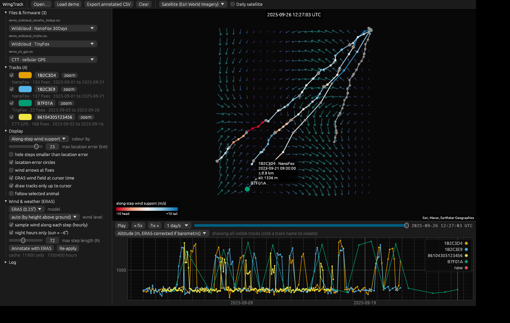
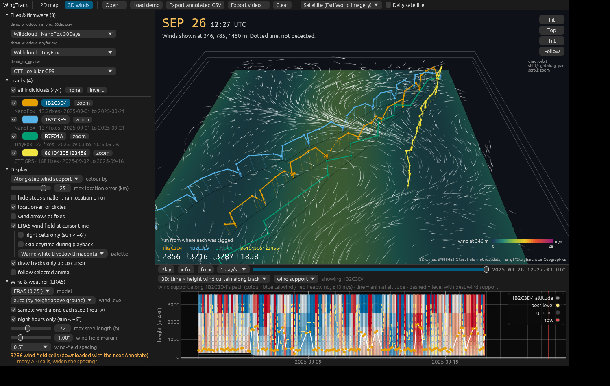

# WingTrack

An interactive animal flight tracker written in Rust — in the spirit of
[BirdTracker](https://dp-00.github.io/BirdTracker/), but built for**Sigfox tags (TinyFox, NanoFox, uWasp)**. It overlays
**daily satellite imagery** and annotates every fix with **ERA5 wind and weather**, including
wind support along each step — the number that matters for Sigfox fixes taken hours apart at the roost.

Runs as a native desktop app (Linux / macOS / Windows) and, from the same code, in the browser
(WebAssembly, deployable to GitHub Pages).



*Demo data shown with an offline test wind field (`WINGTRACK_SYNTHETIC_WIND=1`); with network access the
basemap, daily satellite imagery and real ERA5 data load from the services below.*



*3D view with the demo tracks and the offline synthetic test wind field (`WINGTRACK_SYNTHETIC_WIND=1 WINGTRACK_3D=1`).*

## Features

- **Firmware-aware import** — auto-detects the format of each CSV, with a per-file override:

  | Profile                                | What it reads                                                                                                                                                                           |
  | -------------------------------------- | --------------------------------------------------------------------------------------------------------------------------------------------------------------------------------------- |
  | Wildcloud · TinyFox                   | `Total VeDBA` (cumulative → per-message difference), 24 h activity %, 24 h min/max temperature, 24 h min pressure → max altitude                                                    |
  | Wildcloud · NanoFox 30Days            | 5 × 36-min VeDBA and temperature bins (placed at their window centres), 3 h min pressure → max altitude                                                                               |
  | Wildcloud · NanoFox FineScalePressure | 5 × VeDBA bins + 5 instantaneous pressure readings → barometric altitude at transmission                                                                                              |
  | Movebank · Sigfox                     | `wildcloud_to_movebank()` uploads: Atlas locations + radius, separate VeDBA / pressure / temperature rows (3 h min pressure joined to fixes like `add_min_pressure_to_locations()`) |
  | Movebank · GPS                        | `height-above-msl/ellipsoid`, `ground-speed`, `heading`, `gps:hdop`; drops rows flagged invisible/outlier                                                                       |
  | CTT · cellular GPS                    | CTT portal exports (Time of Fix, Lat/Lng, Altitude, Speed in knots, COG, HDOP, satellites, Nav Type/Error codes) and legacy `GPS_YYYY-MM-DD_HH:MM:SS` files                           |
  | Generic                                | any lat/lon/time CSV, e.g. `flatten_movedata()` output; `era5_*` / `wind_support_flight` columns from `annotate_era5()` are shown as *imported* weather                       |

  Column matching mirrors `harmonize_wc_columns()` in [SigfoxTagPrep](https://github.com/ehurme/SigfoxTagPrep)
  (comma/semicolon/tab delimiters, BOMs, `14.06.2025, 17:56:24` timestamps, `7000 (2/1)` radius strings, strongest RSSI from the base-station field).
- **Sigfox-aware display** — location-error circles from the Atlas radius, a max-radius filter,
  dashed steps where the movement is smaller than the combined location error, and an option to hide them.
- **Satellite layers** — Esri World Imagery / OSM / topo / dark basemaps, plus **NASA GIBS daily imagery
  (MODIS Terra, MODIS Aqua, VIIRS)** that switches date with the time cursor, so you can see the fronts the animals crossed.
- **ERA5 wind & weather** (via the [Open-Meteo Historical Weather API](https://open-meteo.com/en/docs/historical-weather-api)):

  - 10 m / 100 m wind, 2 m temperature, MSL & surface pressure, precipitation, cloud cover per fix
  - level chosen from height above ground (barometric: tag pressure vs ERA5 surface pressure; GPS: altitude vs ERA5-derived ground elevation)
  - **wind support, crosswind, airspeed** relative to the step heading
  - **along-step wind support**: hourly samples along the great-circle path between fixes, optionally **night hours only** (sun < −6°)
  - **barometric altitude re-computed with the local ERA5 MSLP** instead of the 1013.25 hPa standard atmosphere
  - ERA5 wind field (arrows) for the hour under the cursor, with a speed legend, drawn **around the animals**: after the
    first *Annotate*, cells within the *wind-field radius* (default 3°, 1° grid) of each animal's position are fetched a
    week at a time as you move through time, optionally night cells only. The arrow palette has a default per basemap
    (bright on satellite imagery, viridis on street/topo maps) and can be changed per basemap. Requests are throttled to
    Open-Meteo's free limits (600 calls/min, 5 000/h) and retried after a rate-limit response.
- **3D winds at multiple altitudes** (*3D winds* tab) — a tilted map with the wind-speed field for one level,
  flowing particles on stacked pressure-level planes (labelled with their geopotential height), tracks drawn at
  flight altitude with drop lines and ground shadows, dotted segments where the animal was not detected,
  named position markers, a big date caption and a "km from where each was tagged" bar. Drag to orbit,
  shift/right-drag to pan, scroll to zoom; *Follow* keeps the selected animal centred.
  - **Two data sources** in one store:
    [Open-Meteo Historical Forecast API](https://open-meteo.com/en/docs/historical-forecast-api) — 1000–700 hPa
    (≈ 110 m – 3 km) wind, geopotential height and temperature from archived GFS / ICON / IFS analyses,
    ~2021 onwards, no key, works in the browser; or an **ERA5 wind cube** exported from your own
    `download_era5.py` files with `tools/era5_wind_cube.py` (any levels, e.g. 1000–500 hPa).
  - **Flight-level annotation** per fix, with the same definitions and column names as
    `SigfoxTagPrep::annotate_era5()`: flight pressure (tag barometer, or GPS altitude converted with the
    profile), `matched_pressure_level` (nearest level), `wind_support_flight`, `crosswind_flight`,
    `airspeed_flight`, `best_wind_level`, `best_wind_support`, `at_best_wind`. Unlike the R function,
    levels below the ground (level pressure > surface pressure) are excluded from the best-level search.
  - **Charts**: a *time × height curtain* of wind support / crosswind / speed along a track's path with the
    animal's altitude and the best level overlaid, a *wind profile* at the selected fix (support, crosswind,
    speed vs height), and time series of flight-level and best-level support.
  - The 3D field follows the animals: nodes within the *field radius* (default 3°) of where they are, fetched a week at
    a time from the cursor day (0.25–2° resolution); along-track profiles are fetched at full 0.25° resolution.
  - Each level has its own colour (particles, plane outline, label, caption), planes are joined by corner posts, the
    level shown in the colour field is highlighted, and the vertical exaggeration is set automatically (*auto*) so the
    stack is about 20 % as tall as the field is wide.
- **Timeline & charts** — play/pause at 10 min/s … 1 week/s, step fix-by-fix (← →, Space),
  linked chart of altitude, speeds, wind components, ERA5 variables, location error or raw sensor
  streams (VeDBA, tag temperature, pressure, activity). Click the chart to jump in time; click a fix on the map to inspect it,
  with a day/twilight/night indicator for the selected animal.
- **Video export** — *Export video…* records the animated map (basemap, satellite layer, ERA5 wind field,
  legend, clock) plus, optionally, the timeline and sensor chart. Frames are captured at a fixed amount of tracking
  time per frame, so the result does not depend on render speed. MP4 (H.264) needs `ffmpeg` on PATH (desktop only);
  animated GIF works everywhere, including the web build. Honours *skip daytime during playback*.
- **Phones and tablets** — the web app adapts to narrow screens: the side panel starts hidden behind a
  **Panel** button (it also collapses on desktop), file and layer controls move into **File** / **Layers** menus,
  the chart can be hidden with **Chart**, a tapped fix shows its summary on the map, and the 3D view supports
  one-finger orbit, two-finger pan, pinch-zoom and twist-to-rotate.
- **Shareable links** — **Share** makes a link that opens exactly the current view for anyone: data, time, 2D map
  position/zoom or 3D camera, tab, basemap and satellite layer, track visibility/colours/selection, chart, and all
  wind and 3D settings. On the web the address bar updates as you go (like a map app), so a reload or a bookmark keeps
  the view. Data travels as `demo=1`, as `data=<url>` for files opened with **File → Open URL…** (Dropbox share links and GitHub
  file links are converted to direct downloads automatically), or embedded gzip-compressed in the link for local files (optional; long links for big files). Weather is
  downloaded again on the recipient's side. Everything sits after `#`, so it is never sent to the web server.
  The desktop app makes links to the web app and also opens them: `wingtrack "https://…/WingTrack/#v=1&…"`.
- **Export** — one CSV with every derived column (`wind_support_ms`, `segment_wind_support_ms`, `altitude_era5_msl_corrected_m`, …)
  and Movebank-style names, ready for R:

  ```r
  library(move2)
  d <- read.csv("wingtrack_annotated.csv")
  m <- mt_as_move2(d, coords = c("location_long", "location_lat"), time_column = "timestamp",
                   track_id_column = "individual_local_identifier", crs = 4326,
                   na.fail = FALSE)
  ```

## Installation and running

You need Rust (1.95 or newer) and Git. Everything else is downloaded automatically the first time you build.

### 1. Install Rust

**Windows**

1. Download and run `rustup-init.exe` from <https://rustup.rs>.
2. If it says the *Visual Studio C++ Build Tools* are missing, let it install them (or install
   [Build Tools for Visual Studio](https://visualstudio.microsoft.com/visual-cpp-build-tools/) with the
   *Desktop development with C++* workload), then run `rustup-init.exe` again.
3. Accept the default installation.
4. **Close and reopen** your terminal (Command Prompt, PowerShell or the VS Code terminal) so it finds `cargo`.

**macOS / Linux**

```bash
curl --proto '=https' --tlsv1.2 -sSf https://sh.rustup.rs | sh
source "$HOME/.cargo/env"        # or open a new terminal
```

On macOS, if prompted, install the Xcode command-line tools (`xcode-select --install`).
On Debian/Ubuntu, also install the libraries the window system needs:

```bash
sudo apt install build-essential pkg-config libxcb-render0-dev libxcb-shape0-dev \
  libxcb-xfixes0-dev libxkbcommon-dev libssl-dev
```

Check the install (open a new terminal first):

```bash
rustc --version      # should print 1.95 or newer; if older, run: rustup update
cargo --version
```

### 2. Get the code

```bash
git clone https://github.com/ehurme/WingTrack.git
cd WingTrack
```

(No Git? Click **Code → Download ZIP** on GitHub, unzip it, and `cd` into the unzipped folder.)
To update later, run `git pull` inside the folder.

### 3. Run the desktop app

From inside the repository folder:

```bash
cargo run --release
```

The first build downloads and compiles all dependencies and takes a few minutes. Later runs start in seconds.
The app window opens when the build finishes.

To start with the simulated demo files already loaded:

| Shell                  | Command                                              |
| ---------------------- | ---------------------------------------------------- |
| macOS / Linux / Git Bash | `WINGTRACK_DEMO=1 cargo run --release`             |
| PowerShell             | `$env:WINGTRACK_DEMO=1; cargo run --release`         |
| Command Prompt (cmd)   | `set WINGTRACK_DEMO=1 && cargo run --release`        |

The compiled program is saved as `target/release/wingtrack` (`wingtrack.exe` on Windows); you can run that
file directly next time without `cargo`. Ready-made builds for Windows, macOS and Linux can also be downloaded
from the latest run on the repository's **Actions** tab (artifacts `wingtrack-<os>`).

### 4. Using it

- Load data with **Open…** or by dragging CSV files onto the window. The firmware profile is detected
  automatically; change it per file under *Files & firmware* if needed.
- **Load demo** loads three simulated files (a NanoFox 30Days Wildcloud export with two Leisler's bats,
  a TinyFox export, a CTT GPS export) — simulated tracks, not real data.
- **Annotate with ERA5** in the side panel downloads wind and weather (internet connection needed).
- Space plays/pauses, ← / → step between fixes.

### Optional: video export as MP4

GIF export works out of the box. For MP4, install [ffmpeg](https://ffmpeg.org/download.html) and make sure
`ffmpeg -version` works in a new terminal (Windows: `winget install ffmpeg`; macOS: `brew install ffmpeg`;
Ubuntu: `sudo apt install ffmpeg`). Restart WingTrack afterwards.

### Optional: run in the browser

```bash
rustup target add wasm32-unknown-unknown
cargo install --locked trunk          # one-time, takes a few minutes
trunk serve --release                 # then open http://127.0.0.1:8080
```

### Tests

```bash
cargo test --lib      # parsers, weather batching/annotation, geodesy, export round-trip, video encoding
```

### Troubleshooting

| Problem | Fix |
| ------- | --- |
| `'cargo' is not recognized` / `cargo: command not found` | Rust is not on your PATH yet — open a new terminal. On Windows, re-run `rustup-init.exe` if it still fails. |
| `'trunk' is not recognized` | Install it: `cargo install --locked trunk` (only needed for the browser version). |
| `linker 'link.exe' not found` (Windows) | Install the Visual Studio C++ Build Tools (step 1). |
| `package requires rustc 1.95` | `rustup update` |
| `could not find Cargo.toml` | You are not in the repository folder — `cd` into `WingTrack` first. |
| MP4 greyed out in *Export video* | ffmpeg was not found on PATH; install it and restart the app, or use GIF. |

### Continuous integration

Pushing to `main` on GitHub runs `.github/workflows/ci.yml`: tests + clippy, desktop builds for
Linux/macOS/Windows (downloadable artifacts), and a web build deployed to GitHub Pages
(enable *Settings → Pages → Source: GitHub Actions*).

## ERA5 wind cube for the 3D view

```bash
pip install xarray pandas numpy cfgrib netCDF4
python tools/era5_wind_cube.py --era5-dir //10.0.16.7/grpdechmann/Postdoc-EdwardHurme/EnvData \
    --tracks wingtrack_annotated.csv --step 0.5 --out my_cube.csv.gz
```

The area and dates come from the track file (plus a 2° margin); `--bbox S N W E --start --end` sets them
explicitly. Add `"geopotential"` to `pressure_level_variables` in `era5_config.json` for exact level heights; without
it heights are integrated from MSLP and temperature. Load the file with *3D wind → Import ERA5 cube…*.

## Adding a tag type / firmware

Implement the `Firmware` trait in `src/firmware/` and add it to `registry()`:

```rust
pub trait Firmware: Send + Sync {
    fn id(&self) -> &'static str;          // stable id, written to exports
    fn label(&self) -> &'static str;       // shown in the per-file dropdown
    fn description(&self) -> &'static str;
    fn detect(&self, t: &Table) -> f32;    // 0..1 confidence from the header (and rows)
    fn parse(&self, t: &Table) -> Result<ParseOutput, String>;
}
```

`Table` gives tolerant column lookup on normalised headers (`"Radius (m) (Source/Status)"` → `radius_m_source_status`).
Fixes carry location source and error, altitude and its source (GPS, instantaneous or window-minimum pressure),
and sensor samples go into `Track::sensors` so they appear in the chart automatically.

## Notes and limits

- ERA5 single levels stop at **100 m**; use the *3D winds* source (Open-Meteo pressure levels or an ERA5 cube) for
  wind at flight altitude. Files annotated with `annotate_era5()` in R also load, with their flight-level columns shown as imported.
- Open-Meteo pressure levels come from operational forecast archives (not ERA5) and start around 2021–2022; for older
  tracks, or to match published analyses, export an ERA5 cube. With ECMWF IFS some intermediate levels (975, 950, 900, 800 hPa)
  are missing; GFS has all of them. Each pressure-level request asks for 33 variables, which Open-Meteo counts as several calls —
  keep the field resolution coarse (1°) for large areas.
- Open-Meteo is free for non-commercial use (≈10 000 calls/day; a multi-location month request counts as several calls).
  Along-step sampling adds grid cells between fixes; turn it off for very large GPS datasets.
- ERA5 is available with a ~5–6 day delay; newer fixes stay un-annotated.
- GIBS true-colour layers are daytime overpasses — useful for synoptic weather, not for the night itself.
- Coordinates and times are treated as WGS84 and UTC.

## Code layout

| File               | Role                                                                                |
| ------------------ | ----------------------------------------------------------------------------------- |
| `src/model.rs`   | `Track`, `Fix`, `SensorSample`, weather annotation struct                     |
| `src/table.rs`   | CSV reader (delimiter sniffing, header normalisation, timestamp formats)            |
| `src/firmware/`  | one module per data source; `mod.rs` holds the trait, registry and shared helpers |
| `src/weather.rs` | ERA5 request planning, response cache, wind support / along-step annotation         |
| `src/geo.rs`     | great-circle maths, solar elevation, barometric altitude, wind vectors              |
| `src/tiles.rs`   | basemaps and NASA GIBS date-specific tile sources                                   |
| `src/wind3d.rs`  | pressure-level profiles: Open-Meteo + ERA5-cube sources, interpolation, flight-level annotation, curtains, field slices |
| `src/view3d.rs`  | CPU-projected 3D view: textured ground tiles, wind raster, level planes, particles, tracks at altitude |
| `tools/era5_wind_cube.py` | export an ERA5 wind cube (CSV.gz) from `download_era5.py` folders for the 3D view |
| `src/app.rs`     | egui UI: map plugin, timeline, charts, export                                       |
| `src/video.rs`   | video export: frame capture/cropping, MP4 (ffmpeg) and GIF encoders                 |
| `src/demo.rs`    | simulated demo files in raw export formats                                          |

MIT licence. Map data © OpenStreetMap contributors, Esri, CARTO; imagery NASA EOSDIS GIBS; weather ERA5 (Copernicus) via Open-Meteo.
